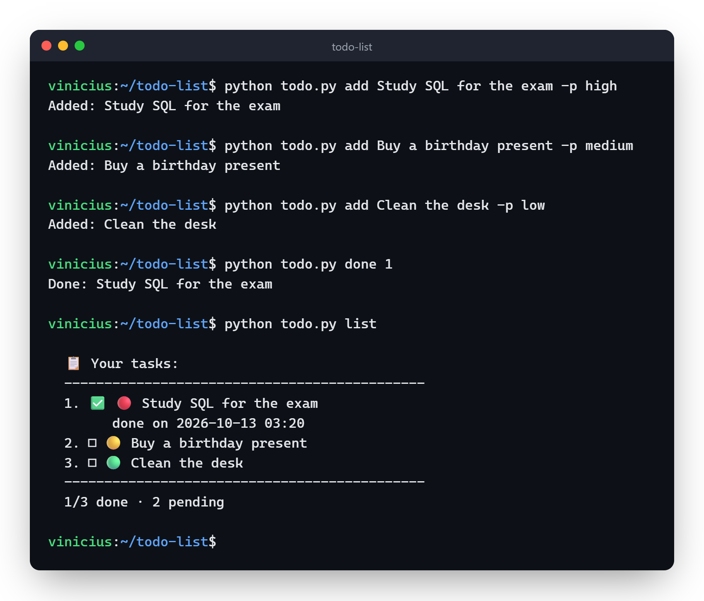

# To-Do List


A to-do list for the terminal, written in Python. It was one of my first projects.

You can add tasks with a priority (low, medium or high), mark them as done, reopen, edit, remove and clear the ones that are already done. Everything is saved to a `tasks.json` in the same folder as the script.

## How to use

```bash
git clone https://github.com/ViniciuscLemos/todo-list
cd todo-list
python todo.py
```

You don't need to install anything besides Python 3.

There are also direct commands, for when you don't want to open the menu:

```bash
python todo.py add Study SQL for the exam -p high
python todo.py list --pending
python todo.py list --done
python todo.py list -p high   # only one priority
python todo.py list --sort    # high first, numbers don't change
python todo.py done 1 3       # done, reopen and rm take more than one number
python todo.py edit 1 -n "Study SQL and Python" -p m
python todo.py find sql
python todo.py stats
python todo.py list --json   # raw tasks, for scripts
python todo.py list --md     # markdown checklist, to paste somewhere
python todo.py move 3 1      # task 3 goes to the top
python todo.py rm 2
python todo.py clear          # removes the done ones
python todo.py --help
```

When something goes wrong (a task number that doesn't exist, for example) the command prints the error and exits with code 1, so it also works in scripts.



## What it looks like


The dot is the priority (red is high, yellow medium, green low). When picking the priority you can type `medium`, `Medium` or just the initial (`h`, `m`, `l`).

If `tasks.json` is corrupted or in a weird format, the program keeps a copy of it as `tasks.json.corrupted` and starts a new list instead of crashing. It also writes to a temp file before swapping it with the real one, so if the computer shuts down halfway through, the old list is still intact.

## Tests

```bash
python -m unittest discover -s tests
```
